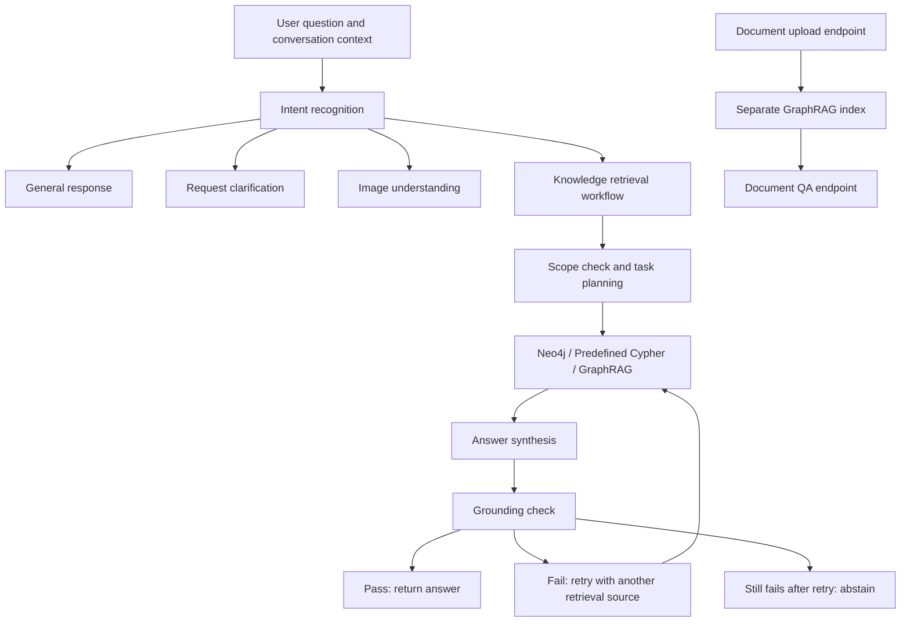

# AssistGen · Intelligent Customer Service Agent

[中文](README.md) | English

An intelligent customer service project for smart home e-commerce, built with **FastAPI, LangGraph, Neo4j, and Microsoft GraphRAG**. It combines large language models, intent routing, knowledge retrieval, and answer grounding checks to handle customer questions through retrieval, generation, and verification.

AssistGen supports the DeepSeek API and local models served by Ollama. It provides streaming conversations, document question answering, image understanding, web search, and conversation history management for learning, demonstrations, and business prototyping.

## Features

| Module | Capabilities |
| --- | --- |
| Streaming chat and reasoning | DeepSeek / Ollama integration with SSE responses |
| Intent recognition | Routes requests into general questions, clarification, knowledge retrieval, image queries, and file queries |
| Knowledge graph question answering | Retrieves products, orders, and related information using Neo4j, generated Cypher, and predefined queries |
| Agent orchestration | Uses LangGraph for scope checks, task planning, tool execution, and answer synthesis |
| Document question answering | Builds separate GraphRAG indexes from uploaded PDF, DOCX, TXT, Markdown, and CSV files |
| Image understanding | Calls a separately configured vision model and uses image descriptions to produce customer service responses |
| Web search | Retrieves external information through SerpAPI to support answers |
| Hallucination guard | Checks evidence against candidate answers in the knowledge retrieval workflow; retries with another retrieval source and abstains if verification still fails |
| Users and conversations | Registration, login, message history, conversation renaming, and deletion |
| Caching and evaluation | Redis context and semantic caching, intent hard-negative mining, offline grounding evaluation, and Ollama benchmarks |

> Implementation status: the `file-query` node in the main intent routing workflow is still a TODO. Document question answering is available through the separate upload and `/chat-rag` endpoints. The hallucination guard runs within the knowledge retrieval workflow and does not cover all general chat responses.

## Workflow



## Technology Stack

- **Backend:** Python, FastAPI, Uvicorn, and Pydantic.
- **Agent orchestration:** LangGraph, LangChain, structured output, and tool calling.
- **Model services:** DeepSeek API, Ollama, and a separately configured vision API.
- **Retrieval and storage:** Neo4j, Microsoft GraphRAG, MySQL, SQLAlchemy, and Redis.
- **Document processing:** PyPDF2 and python-docx.
- **Web interface:** FastAPI serves the frontend build artifacts in `llm_backend/static/dist/`. The current project root does not include a separate frontend build project.

## Project Structure

```text
deepseek_agent/
├── README.md                     # Chinese documentation
├── README.en.md                  # English documentation
├── CHANGELOG.md
├── requirements.txt
├── .env.example                  # Environment variable template
├── .gitignore
└── llm_backend/
    ├── main.py                   # FastAPI application and business endpoints
    ├── run.py                    # Server entry point
    ├── app/
    │   ├── api/                  # Registration, login, and authentication
    │   ├── core/                 # Configuration, database, logging, and security
    │   ├── models/               # User, conversation, and message models
    │   ├── schemas/              # Request and response schemas
    │   ├── services/             # Models, search, caching, indexing, and document QA
    │   ├── lg_agent/
    │   │   ├── lg_builder.py     # Main Agent workflow
    │   │   ├── intent/           # Classification, few-shot examples, and auditing
    │   │   └── kg_sub_graph/     # Graph retrieval and multi-tool workflows
    │   ├── graphrag/             # GraphRAG source and configuration
    │   └── test/                 # Tests and benchmarking tools
    ├── scripts/                  # Database initialization and offline evaluation
    ├── data/                     # Intent and grounding data and evaluation guides
    ├── docs/                     # Additional documentation
    ├── static/dist/              # Web interface build artifacts
    └── uploads/                  # Runtime uploads
```

## Local Setup

### 1. Prepare the Environment

Python 3.11 in a dedicated virtual environment is recommended. The full dependency set includes GraphRAG and model-related packages, which can require substantial installation time and disk space.

Prepare the services required by the features you intend to use:

| Service | Purpose |
| --- | --- |
| MySQL | Persistent storage for users, conversations, and messages |
| Redis | Context and semantic caching |
| DeepSeek or Ollama | Chat and Agent model services |
| Ollama embedding model | Default embedding configuration and document indexing |
| Neo4j | Product and order graph retrieval; business data matching the query schema must be prepared separately |
| SerpAPI / vision model | Web search and image understanding, respectively |

The settings class includes several required fields. Keep all fields from the environment template even if you do not immediately use every feature.

### 2. Install Dependencies

Run these commands from the project root containing `requirements.txt`:

```powershell
python -m venv .venv
.\.venv\Scripts\Activate.ps1
python -m pip install --upgrade pip
python -m pip install -r requirements.txt
```

On macOS / Linux, activate the virtual environment with:

```bash
source .venv/bin/activate
```

### 3. Configure Environment Variables

Copy the template from the project root:

```powershell
Copy-Item .env.example llm_backend/.env
```

Settings are loaded from **`llm_backend/.env`**. Replace the template's example API keys, database passwords, and local network addresses. Configure the required fields locally using the environment template. Keep real credentials out of the repository.


Retain and configure the required fields from `.env.example`.

- Model names are examples and must match those available from your provider. Select local model sizes according to your hardware.
- For Ollama, pull the configured models first, for example `ollama pull bge-m3`, and confirm that the service is reachable.
- Image understanding requires `VISION_API_KEY`, `VISION_BASE_URL`, and `VISION_MODEL`. Web search requires `SERPAPI_KEY`.
- The environment template sets `INTENT_ROUTER_MODE=structured`. The fallback in code may differ, so set your preferred mode explicitly.
- Document indexing reads `app/graphrag/data/settings.yaml`. Check its model and path settings before use. Indexing generates local caches and may incur model API charges.

### 4. Initialize MySQL

Create a dedicated database with the name configured in `DB_NAME`:

```sql
CREATE DATABASE assist_gen CHARACTER SET utf8mb4;
```

Then enter the backend directory and initialize the tables:

```powershell
cd llm_backend
python scripts/init_db.py
```

**Warning: this script drops existing ORM tables before recreating them, deleting the corresponding user, conversation, and message data. Run it only against a new database. Back up existing data and use a migration strategy for databases already in use.**

Prepare Neo4j business data and GraphRAG indexes separately. The MySQL initialization script does not create them.

### 5. Start the Server

From `llm_backend`, run:

```powershell
python run.py
```

The server listens on `0.0.0.0:8000` by default. Open:

- Web interface: <http://localhost:8000/>
- Interactive API documentation: <http://localhost:8000/docs>
- Health check: <http://localhost:8000/health>

Register and log in through the interface, then try a general conversation. Graph and document question answering require their respective services and data. A successful `/health` response confirms that the application responds; it does not verify the readiness of all external services.

## Intent Optimization and Hallucination Evaluation

The project includes two evaluation workflows:

- **Intent recognition optimization:** collect audit records, manually label queries, mine high-confidence misclassifications, update few-shot examples, and measure Accuracy, Macro-F1, and per-class metrics.
- **Hallucination guard evaluation:** use fixed questions, retrieved evidence, and candidate answers to measure hallucination rates, correct blocking rates, and false blocking rates, with A/B comparisons before and after the guard.

See the following guides for usage and data formats. These supporting documents are currently in Chinese:

- [Intent recognition and hard-negative mining](llm_backend/data/intent/README.md)
- [Grounding guard and offline evaluation](llm_backend/data/hallucination/README.md)
- [Intent dataset documentation](llm_backend/docs/intent_dataset_ecd_ambiguous.md)

Run the following unit tests from `llm_backend`:

```powershell
python -m unittest app.test.test_intent_hard_negative app.test.test_grounding_guard
```

Install dependencies and prepare the environment configuration before running tests. Offline model evaluations may call external services and incur charges. Results from example data or controlled local experiments do not establish production performance. Some datasets are excluded by `.gitignore`; prepare or generate them using the relevant guides after cloning the repository.

## Known Limitations and Troubleshooting

- **Incomplete file routing:** `create_file_query` in the main Agent remains a TODO. Use the separate document upload and QA endpoints.
- **In-memory Agent state:** the main graph uses `MemorySaver`, so this state is lost when the process restarts. MySQL message history is stored through a separate persistence mechanism.
- **Scanned PDFs:** document extraction does not include OCR. Convert scanned documents into text-readable files first.
- **Configuration validation errors:** check that `.env` is in `llm_backend/`, all required fields are present, and service enum values are lowercase.
- **Failed or empty knowledge queries:** check the Neo4j connection, business graph schema, GraphRAG configuration, and generated indexes. Starting a database alone does not populate its knowledge data.
- **Web interface fails to load:** confirm that `llm_backend/static/dist/index.html` and its static assets are present.

## Publishing and Deployment

The current server entry point enables development hot reload, and CORS settings are permissive. Before external deployment, disable `reload`, restrict allowed origins, replace `SECRET_KEY`, and complete authentication and user resource access controls for business endpoints.

Before uploading to GitHub, exclude actual `.env` files, secrets, user uploads, audit logs, local caches, database files, and evaluation data containing personal information. Environment templates should contain placeholders only. Follow the original licenses and redistribution terms for third-party datasets.

## Third-Party Components and Licensing

The project integrates third-party components, including Microsoft GraphRAG. Preserve their copyright and license notices. The project root currently has no standalone `LICENSE` file. Before publishing it as open source, confirm the origin and permitted use of the project code and data, then add an appropriate license.

See [CHANGELOG.md](CHANGELOG.md) for version history.


