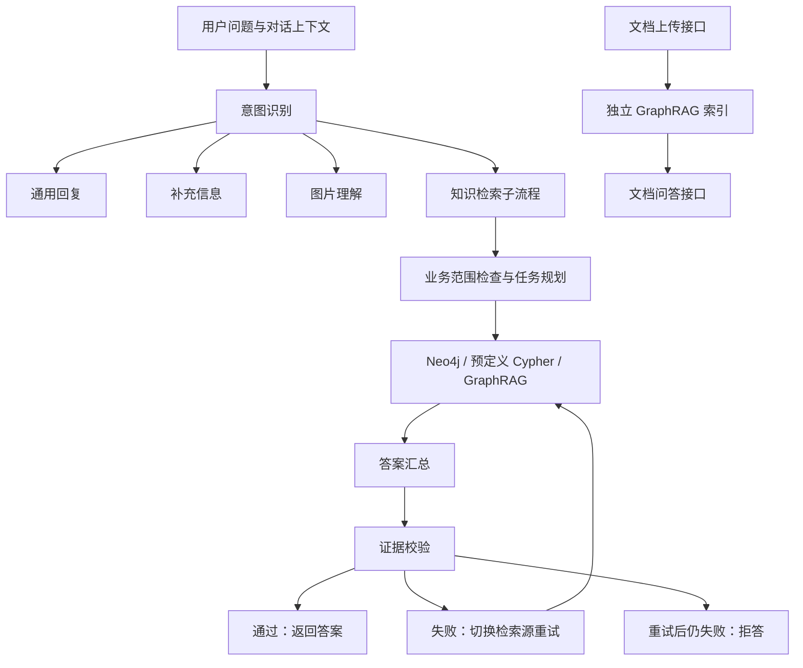

# AssistGen · 智能客服 Agent

面向电商智能家居场景的智能客服项目，基于 **FastAPI、LangGraph、Neo4j 与 Microsoft GraphRAG** 构建，结合大语言模型、意图路由、知识检索和回答证据校验，实现从用户提问到检索、生成与校验的客服问答流程。

支持 DeepSeek 在线服务与 Ollama 本地模型，提供流式对话、文档问答、图片理解、联网搜索和历史会话管理，适合用于 Agent / RAG 技术学习、项目演示与业务原型验证。

## 功能特性

| 模块 | 说明 |
| --- | --- |
| 流式对话与推理 | 接入 DeepSeek / Ollama，通过 SSE 返回模型输出 |
| 意图识别 | 将请求路由到通用问答、补充信息、知识检索、图片和文件等类别 |
| 图谱问答 | 结合 Neo4j、动态 Cypher 与预定义查询，检索商品、订单及关联信息 |
| Agent 工作流 | 基于 LangGraph 编排业务范围检查、任务规划、工具执行和答案汇总 |
| 文档问答 | 上传 PDF、DOCX、TXT、Markdown、CSV，构建独立 GraphRAG 索引并进行问答 |
| 图片理解 | 调用独立配置的视觉模型，结合图片描述生成客服回复 |
| 联网搜索 | 通过 SerpAPI 获取外部信息并辅助回答 |
| 回答证据校验 | 在知识检索子流程中检查证据和候选答案；校验失败时尝试切换检索源，仍失败则拒答 |
| 用户与会话 | 提供注册、登录、历史消息查询、会话重命名和删除 |
| 缓存与评测 | Redis 上下文与语义缓存、意图难负样本挖掘、回答校验离线评测、Ollama 性能测试 |

> 功能边界：意图路由中的 `file-query` 节点目前仍为 TODO；文档问答通过独立的上传和 `/chat-rag` 接口使用。回答证据校验接入知识检索子流程，并不覆盖所有通用对话输出。

## 工作流程



## 技术栈

- **服务端**：Python、FastAPI、Uvicorn、Pydantic。
- **Agent 编排**：LangGraph、LangChain、结构化输出与工具调用。
- **模型服务**：DeepSeek API、Ollama、独立视觉模型接口。
- **检索与存储**：Neo4j、Microsoft GraphRAG、MySQL、SQLAlchemy、Redis。
- **文档处理**：PyPDF2、python-docx。
- **Web 界面**：由 FastAPI 托管 `llm_backend/static/dist/` 中的前端构建产物；当前项目根目录未提供独立前端构建工程。

## 项目结构

```text
deepseek_agent/
├── README.md
├── CHANGELOG.md
├── requirements.txt
├── .env.example                  # 环境变量模板
├── .gitignore
└── llm_backend/
    ├── main.py                   # FastAPI 应用与业务接口
    ├── run.py                    # 服务启动入口
    ├── app/
    │   ├── api/                  # 注册、登录等认证接口
    │   ├── core/                 # 配置、数据库、日志和安全组件
    │   ├── models/               # 用户、会话和消息模型
    │   ├── schemas/              # 请求与响应结构
    │   ├── services/             # 模型、搜索、缓存、索引和文档问答
    │   ├── lg_agent/
    │   │   ├── lg_builder.py     # 主 Agent 工作流
    │   │   ├── intent/           # 意图分类、few-shot 和审计
    │   │   └── kg_sub_graph/     # 图谱检索与多工具子流程
    │   ├── graphrag/             # GraphRAG 相关源码与配置
    │   └── test/                 # 测试与性能测试工具
    ├── scripts/                  # 数据库初始化与离线评测脚本
    ├── data/                     # 意图与回答校验数据、评测说明
    ├── docs/                     # 补充文档
    ├── static/dist/              # Web 界面构建产物
    └── uploads/                  # 运行时上传文件
```

## 本地运行

### 1. 准备环境

建议使用 Python 3.11 创建独立虚拟环境；完整依赖中包含 GraphRAG 和模型相关组件，安装时间与资源占用较大。

按使用功能准备以下服务：

| 服务 | 用途 |
| --- | --- |
| MySQL | 用户、会话与消息持久化 |
| Redis | 上下文与语义缓存 |
| DeepSeek 或 Ollama | 对话与 Agent 模型服务 |
| Ollama Embedding 模型 | 默认嵌入配置及文档索引 |
| Neo4j | 商品、订单等图谱检索；需自行准备符合查询 Schema 的业务数据 |
| SerpAPI / 视觉模型 | 分别用于联网搜索和图片理解 |

当前配置类包含多项必填字段，即使暂不使用某个功能，也应保留环境模板中的字段。

### 2. 安装依赖

在包含 `requirements.txt` 的项目根目录运行：

```powershell
python -m venv .venv
.\.venv\Scripts\Activate.ps1
python -m pip install --upgrade pip
python -m pip install -r requirements.txt
```

macOS / Linux 激活虚拟环境的命令为：

```bash
source .venv/bin/activate
```

### 3. 配置环境变量

在项目根目录复制模板：

```powershell
Copy-Item .env.example llm_backend/.env
```

配置实际从 **`llm_backend/.env`** 读取。编辑该文件，替换模板中的示例密钥、数据库密码和局域网地址。具体配置请在本地参考环境模板填写，不要将真实密钥上传到仓库。


请保留 `.env.example` 中的必填字段，并注意：

- 模型名称为配置示例，需与实际服务支持的模型一致；本地模型大小应按硬件选择。
- 使用 Ollama 时，先拉取所配置的模型，例如 `ollama pull bge-m3`，并确认服务可访问。
- 图片理解需填写 `VISION_API_KEY`、`VISION_BASE_URL`、`VISION_MODEL`；联网搜索需填写 `SERPAPI_KEY`。
- `INTENT_ROUTER_MODE` 在环境模板中为 `structured`；代码中的缺省值可能不同，请显式设置所需模式。
- 文档索引会读取 `app/graphrag/data/settings.yaml`。使用前检查其中的模型与路径设置，索引过程会产生模型调用费用和本地缓存。

### 4. 初始化 MySQL

先在 MySQL 中创建专用数据库，名称与 `DB_NAME` 一致：

```sql
CREATE DATABASE assist_gen CHARACTER SET utf8mb4;
```

随后进入后端目录初始化表结构：

```powershell
cd llm_backend
python scripts/init_db.py
```

**注意：该初始化脚本会先删除已有 ORM 表，再重新建表，会清空相应用户、会话和消息数据。仅对全新数据库执行；已有数据时应先备份并使用迁移方案。**

Neo4j 业务数据与 GraphRAG 知识索引需要单独准备，MySQL 初始化脚本不会创建这些数据。

### 5. 启动服务

在 `llm_backend` 目录中运行：

```powershell
python run.py
```

默认监听 `0.0.0.0:8000`，本机访问：

- Web 界面：<http://localhost:8000/>
- 交互式 API 文档：<http://localhost:8000/docs>
- 健康检查：<http://localhost:8000/health>

可先通过界面注册并登录，再测试普通对话；图谱问答、文档问答等功能需完成对应服务与数据配置。`/health` 返回正常仅表示应用可以响应，不代表所有外部服务均已就绪。

## 评测与验证

项目包含意图路由和回答证据校验两条评测流程：

- **意图识别**：收集审计记录、人工标注、挖掘高置信度错误样本、更新 few-shot，并统计 Accuracy、Macro-F1 和各类别指标。
- **回答证据校验**：基于固定问题、检索证据与候选答案，评估幻觉率、正确拦截率和误拦率，支持守卫前后 A/B 对比。

使用方法与数据格式见：

- [意图识别与难负样本闭环](llm_backend/data/intent/README.md)
- [回答证据校验与离线评测](llm_backend/data/hallucination/README.md)
- [意图数据集说明](llm_backend/docs/intent_dataset_ecd_ambiguous.md)

在 `llm_backend` 目录中可运行以下单元测试：

```powershell
python -m unittest app.test.test_intent_hard_negative app.test.test_grounding_guard
```

测试需先安装依赖并准备环境配置。离线模型评测可能调用外部服务并产生费用；示例数据结果和本地受控实验结果不等同于线上业务效果。部分数据受 `.gitignore` 排除，克隆仓库后需自行准备或按对应说明生成。

## 已知限制与常见问题

- **文件路由尚未完成**：主 Agent 的 `create_file_query` 仍为 TODO；请使用独立文档上传与问答接口。
- **Agent 状态为进程内存存储**：主图使用 `MemorySaver`，服务重启后不保留该部分状态；MySQL 历史消息属于独立的持久化机制。
- **扫描版 PDF**：当前文档提取不包含 OCR，需先转换为可提取文字的文档。
- **配置校验失败**：检查 `.env` 是否位于 `llm_backend/`、必填字段是否完整、服务枚举是否使用小写值。
- **知识查询失败或为空**：检查 Neo4j 连接、业务图谱 Schema、GraphRAG 配置和已生成的索引；仅启动数据库并不代表已具备知识数据。
- **Web 页面无法加载**：检查 `llm_backend/static/dist/index.html` 与静态资源是否完整。

## 发布与部署

当前启动入口启用了开发热重载，CORS 使用宽泛配置。对外部署前，应关闭 `reload`、配置允许访问的域名、替换 `SECRET_KEY`，并补齐业务接口的鉴权和用户资源访问控制。

上传 GitHub 前，检查并排除实际 `.env`、密钥、用户上传文件、审计日志、本地缓存、数据库文件及含个人信息的评测数据。环境模板仅保留占位值；第三方语料应遵守原始许可与再分发要求。

## 第三方组件与许可

项目集成了 Microsoft GraphRAG 等第三方组件，对应版权与许可声明应保留。当前项目根目录尚未提供独立 `LICENSE` 文件；如需对外开源，请先确认项目代码和数据的来源及授权范围，再添加适用的许可证。

版本记录见 [CHANGELOG.md](CHANGELOG.md)。


